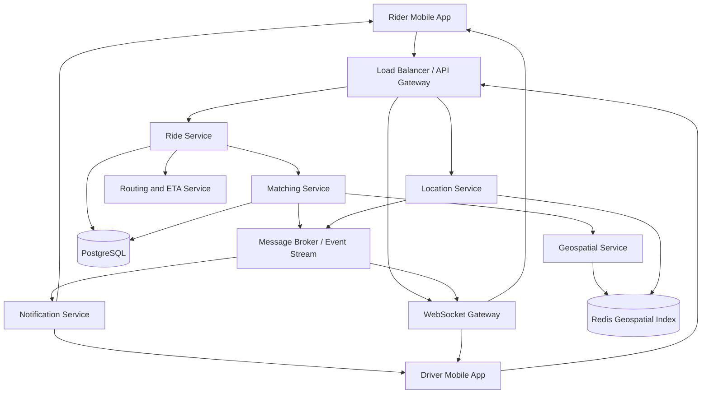
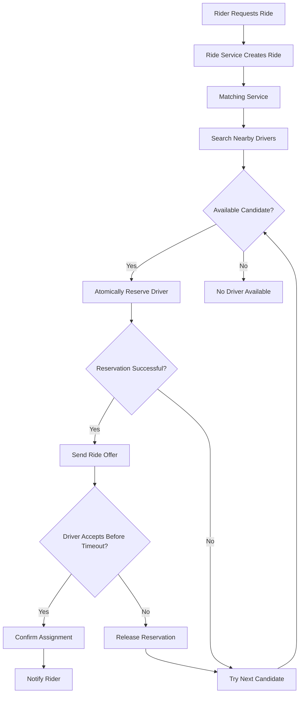
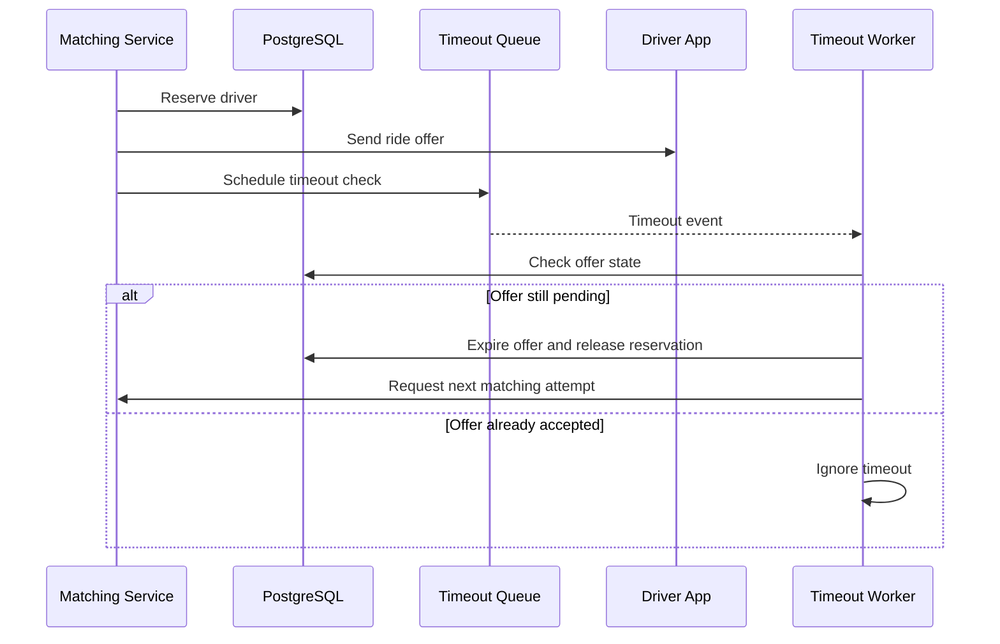
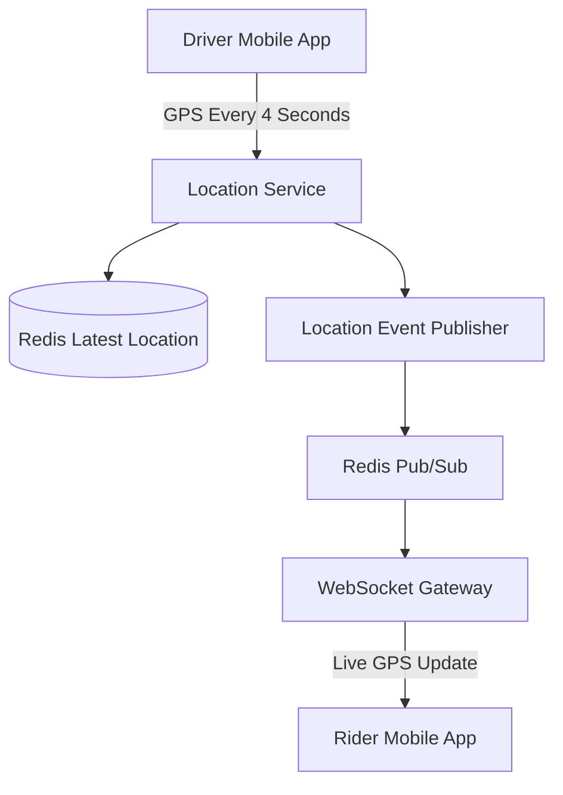
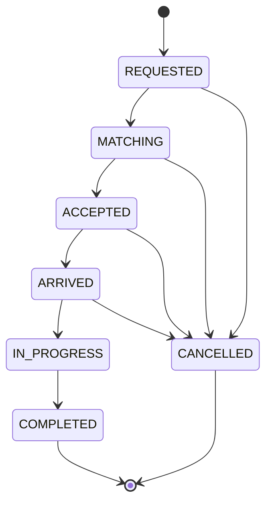

# Design Uber — High-Level System Design

## 1. Problem Statement

Design a scalable ride-hailing platform similar to Uber that connects riders with nearby available drivers, supports real-time GPS tracking, calculates estimated arrival times, and manages the complete ride lifecycle.

The system should support millions of users, handle frequent location updates, prevent duplicate driver assignments, and remain highly available during traffic spikes and infrastructure failures.

---

## 2. Functional Requirements

1. **Ride Request:** Riders can request rides by providing pickup and destination locations.
2. **Driver Matching:** Find nearby available drivers and match them with riders.
3. **Real-Time Location Tracking:** Drivers send GPS updates approximately every 4 seconds.
4. **Route and ETA Calculation:** Calculate routes and estimated arrival times.
5. **Driver Acceptance/Rejection:** Drivers can accept or reject ride requests.
6. **Ride Lifecycle Management:** Manage rides from request creation to completion or cancellation.
7. **Notifications:** Notify riders and drivers about ride assignments and status changes.

### Out of Scope

- Payment processing
- Surge pricing
- Driver ratings and reviews
- Ride-sharing and pooling
- Promotions and discounts

---

## 3. Non-Functional Requirements

| Requirement | Description |
|---|---|
| High Availability | Ride requests and matching should remain available during individual server failures. |
| Low Latency | Driver matching and location updates should be processed quickly. |
| Scalability | Support millions of riders and drivers across multiple regions. |
| Consistency | Prevent a driver from being assigned to multiple active rides. |
| Reliability | Preserve ride information and recover from infrastructure failures. |
| Fault Tolerance | Continue operating when individual components fail. |
| Data Durability | Persist important ride and driver-assignment information. |

### Consistency Requirements

Different components have different consistency needs.

**Driver Location:**
- Eventual consistency is acceptable.
- A slightly delayed GPS update is usually tolerable.
- Stale location data should be detected and removed.

**Driver Assignment:**
- Requires atomic coordination.
- A driver must not be assigned to two active rides simultaneously.
- PostgreSQL conditional updates can enforce assignment correctness.

---

## 4. Capacity Estimation

### Assumptions

| Metric | Value |
|---|---|
| Daily Active Riders | 10 million |
| Registered/Active Drivers | 2 million |
| Concurrent Online Drivers | 25% |
| Daily Ride Requests | 20 million |
| Driver Location Update Interval | 4 seconds |
| Location Update Size | 100 bytes |
| Peak Traffic Multiplier | 3x |

These numbers are hypothetical assumptions for interview estimation.

### 4.1 Ride Requests Per Second

There are 86,400 seconds in a day.

```text
Average Ride RPS = Daily Ride Requests / Seconds Per Day

                 = 20,000,000 / 86,400

                 ≈ 231 requests/second
```

Assuming peak traffic is 5 times the average:

```text
Peak Ride RPS = 231 × 5

              ≈ 1,155 requests/second
```

### 4.2 Driver Location Updates Per Second

Assume 25% of 2 million drivers are online simultaneously.

```text
Online Drivers = 2,000,000 × 0.25

               = 500,000
```

Each online driver sends one GPS update every 4 seconds.

```text
Location Update RPS = 500,000 / 4

                    = 125,000 updates/second
```

At 3x traffic:

```text
Peak Location Update RPS = 125,000 × 3

                         = 375,000 updates/second
```

### 4.3 Storage Estimation

Assume each GPS update contains 100 bytes.

```text
Daily Location Updates = 125,000 × 86,400

                       = 10.8 billion updates/day
```

```text
Daily Storage = 10.8 billion × 100 bytes

              = 1,080,000,000,000 bytes

              ≈ 1.08 TB/day
```

This is raw storage, excluding replication, indexing, metadata, and database overhead.

### Key Observation

Location updates generate significantly more traffic than ride requests.

Therefore, the architecture should separate:

- Ride management and transactional operations
- High-throughput GPS ingestion
- Real-time geospatial indexing
- Historical location storage

---

## 5. High-Level Architecture



### Core Components

**1. API Gateway**

- Entry point for mobile application requests
- Authentication and authorization
- Rate limiting
- Request routing
- Load balancing

**2. Ride Service**

- Creates ride requests
- Maintains ride lifecycle
- Stores ride details in PostgreSQL
- Handles ride cancellation and completion

**3. Matching Service**

- Finds available drivers
- Coordinates driver reservations
- Sends ride offers
- Handles acceptance, rejection, and timeouts

**4. Geospatial Service**

- Searches nearby drivers
- Uses Redis geospatial indexing
- Filters unavailable or stale drivers
- Returns candidate drivers to the Matching Service

**5. Location Service**

- Receives driver GPS updates
- Validates coordinates and timestamps
- Updates Redis
- Publishes location events

**6. WebSocket Gateway**

- Maintains persistent connections
- Sends real-time driver locations to riders
- Delivers live ride-status updates

**7. Notification Service**

- Sends ride offers and notifications
- Notifies riders about accepted and completed rides

**8. Routing and ETA Service**

- Calculates driving routes
- Estimates pickup and trip duration
- Recalculates ETA when necessary

---

## 6. API Design

REST APIs are used for ride management and driver operations.

WebSockets are used for real-time tracking and notifications.

### 6.1 Update Driver Location

```http
POST /api/v1/drivers/location
Authorization: Bearer <token>
```

Request:

```json
{
  "latitude": 40.7128,
  "longitude": -74.0060,
  "timestamp": 1794052800
}
```

Response:

```json
{
  "status": "success"
}
```

The driver identity is obtained from the authenticated session.

### 6.2 Request a Ride

```http
POST /api/v1/rides
Authorization: Bearer <token>
Idempotency-Key: request-123
```

Request:

```json
{
  "pickup": {
    "latitude": 40.7128,
    "longitude": -74.0060
  },
  "dropoff": {
    "latitude": 40.7580,
    "longitude": -73.9855
  }
}
```

Response:

```json
{
  "ride_id": "ride-8812",
  "status": "MATCHING"
}
```

An idempotency key prevents duplicate ride creation when clients retry requests.

### 6.3 Accept Ride

```http
POST /api/v1/rides/{ride_id}/accept
```

Response:

```json
{
  "ride_id": "ride-8812",
  "status": "ACCEPTED"
}
```

Only the driver holding the valid reservation can accept the offer.

### 6.4 Reject Ride

```http
POST /api/v1/rides/{ride_id}/reject
```

### 6.5 Start Ride

```http
POST /api/v1/rides/{ride_id}/start
```

### 6.6 Complete Ride

```http
POST /api/v1/rides/{ride_id}/complete
```

### 6.7 Get Ride Details

```http
GET /api/v1/rides/{ride_id}
```

Response:

```json
{
  "ride_id": "ride-8812",
  "rider_id": "rider-4412",
  "driver_id": "driver-9304",
  "status": "IN_PROGRESS",
  "estimated_arrival_minutes": 12
}
```

---

## 7. Database Design

### Database Selection

| Data | Storage | Reason |
|---|---|---|
| Rider Profiles | PostgreSQL | Structured persistent data |
| Driver Profiles | PostgreSQL | Structured persistent data |
| Ride Details | PostgreSQL | Transactions and consistency |
| Driver Availability | PostgreSQL | Authoritative assignment state |
| Current Driver Locations | Redis | Fast updates and geospatial queries |
| Driver Heartbeats | Redis | Detect stale or disconnected drivers |
| Historical GPS Events | Object Storage | Large-scale historical storage |

### 7.1 Riders Table

```sql
CREATE TABLE riders (
    rider_id UUID PRIMARY KEY,
    name VARCHAR(100),
    email VARCHAR(255) UNIQUE,
    created_at TIMESTAMP DEFAULT CURRENT_TIMESTAMP
);
```

### 7.2 Drivers Table

```sql
CREATE TABLE drivers (
    driver_id UUID PRIMARY KEY,
    name VARCHAR(100),
    vehicle_id VARCHAR(100),
    status VARCHAR(30),
    created_at TIMESTAMP DEFAULT CURRENT_TIMESTAMP
);
```

Possible driver statuses:

```text
OFFLINE
AVAILABLE
RESERVED
BUSY
```

### 7.3 Rides Table

```sql
CREATE TABLE rides (
    ride_id UUID PRIMARY KEY,
    rider_id UUID NOT NULL REFERENCES riders(rider_id),
    driver_id UUID REFERENCES drivers(driver_id),

    pickup_lat DOUBLE PRECISION NOT NULL,
    pickup_lng DOUBLE PRECISION NOT NULL,

    dropoff_lat DOUBLE PRECISION NOT NULL,
    dropoff_lng DOUBLE PRECISION NOT NULL,

    status VARCHAR(30) NOT NULL,

    created_at TIMESTAMP DEFAULT CURRENT_TIMESTAMP,
    started_at TIMESTAMP,
    completed_at TIMESTAMP
);
```

The `driver_id` remains NULL until a driver is assigned.

Production systems should additionally enforce valid state transitions, driver assignment constraints, and appropriate indexes.

---

## 8. Driver Location Tracking with Redis

Uber must frequently update driver coordinates and efficiently find nearby drivers.

Redis provides geospatial commands suitable for maintaining an in-memory location index.

### 8.1 Store Driver Location

```redis
GEOADD drivers:nyc -74.0060 40.7128 driver123
```

Redis uses:

```text
GEOADD key longitude latitude member
```

When the driver moves, the Location Service executes `GEOADD` again using the same driver identifier.

### 8.2 Find Nearby Drivers

```redis
GEOSEARCH drivers:nyc
FROMLONLAT -74.0060 40.7128
BYRADIUS 5 km
ASC
COUNT 20
```

This retrieves up to 20 nearby driver candidates within a 5 km radius, ordered by geographic distance.

The Matching Service then:

1. Checks driver availability.
2. Filters stale locations.
3. Excludes previously rejected candidates.
4. Calculates pickup ETA.
5. Selects the best eligible driver.

The geographically closest driver is not necessarily the fastest driver to reach the rider.

### 8.3 Driver Heartbeats

Each driver sends GPS updates every 4 seconds.

We can maintain a heartbeat key:

```redis
SET driver:123:heartbeat online EX 15
```

The heartbeat expires after 15 seconds unless refreshed.

If the driver disconnects:

- The heartbeat expires.
- The driver is excluded from new matching requests.
- A cleanup worker removes stale entries from the geospatial index.

Important: Expiring the heartbeat does not automatically remove the corresponding Redis geospatial entry.

---

## 9. Driver Matching Algorithm

### Matching Workflow



### Matching Steps

1. Rider requests a ride.
2. Ride Service creates a ride with `MATCHING` status.
3. Matching Service requests nearby drivers from the Geospatial Service.
4. Redis returns nearby candidates.
5. Matching Service checks availability and pickup ETA.
6. Matching Service atomically reserves one driver.
7. Driver receives a ride offer.
8. Driver accepts, rejects, or times out.
9. If accepted, the assignment is confirmed.
10. If rejected or timed out, the reservation is released and another candidate is tried.

---

## 10. Preventing Double Booking

### Problem

Two riders request rides simultaneously.

Both matching requests identify the same available driver.

Without concurrency control, the same driver could be assigned to two riders.

### Solution: Atomic Conditional Update

PostgreSQL can atomically reserve a driver.

```sql
UPDATE drivers
SET status = 'RESERVED'
WHERE driver_id = 'driver-123'
  AND status = 'AVAILABLE';
```

The application checks the number of affected rows.

```text
1 row updated -> Reservation successful

0 rows updated -> Driver is not available
```

Only one concurrent transaction can successfully change the driver's state from `AVAILABLE` to `RESERVED`.

### Reservation Ownership

In a production design, reservations should have unique identifiers and expiration timestamps.

For example:

```text
reservation_id
driver_id
ride_id
expires_at
status
```

When a driver accepts, the system must verify that:

- The reservation belongs to the ride.
- The reservation has not expired.
- The driver has not already been assigned elsewhere.
- The ride is still eligible for assignment.

The final assignment should be committed atomically in the database.

### Redis Distributed Locks

Redis can optionally reduce competing reservation attempts.

```redis
SET driver:123:lock reservation-456 NX EX 10
```

However, a Redis lock alone is insufficient to guarantee correctness because the lock may expire while a service is still processing.

The authoritative database transaction must prevent double booking.

---

## 11. Driver Rejection and Timeout Handling

### Driver Rejection

If the driver rejects an offer:

1. Mark the offer as rejected.
2. Release the reservation if it still belongs to that offer.
3. Restore the driver's availability when appropriate.
4. Exclude the rejected driver from the current matching attempt.
5. Try the next eligible driver.

### Driver Timeout

Suppose a driver does not respond within 15 seconds.

A delayed-message system or timeout scheduler can trigger a retry.



Timeout processing must be idempotent.

If the driver accepts at nearly the same moment as the timeout, only one state transition should succeed.

### Message Queue Selection

Kafka is useful for:

- Ride lifecycle events
- Driver location event streams
- Analytics
- Event replay

AWS SQS or another delayed-job mechanism is useful for:

- Driver response timeouts
- Matching retries
- Background processing

Kafka does not provide a general-purpose delayed-message scheduler by default, so additional scheduling logic would be required.

---

## 12. Real-Time Tracking with WebSockets

### Why WebSockets?

REST APIs are suitable for creating and managing rides.

However, continuously polling for driver locations introduces unnecessary requests and delays.

WebSockets maintain persistent connections and allow the backend to push location updates to riders.

### Real-Time Location Flow



### WebSocket Message Example

```json
{
  "event": "DRIVER_LOCATION_UPDATED",
  "ride_id": "ride-8812",
  "driver_id": "driver-9304",
  "latitude": 40.7128,
  "longitude": -74.0060,
  "timestamp": 1794052800
}
```

### WebSocket Scalability

Assume 1 million riders are simultaneously tracking rides.

If each WebSocket server can reliably handle 50,000 connections:

```text
Required Servers = 1,000,000 / 50,000

                 = 20 servers
```

Additional servers are needed for redundancy, traffic spikes, and failover.

The architecture should include:

- Load balancing
- Horizontally scaled WebSocket gateways
- Connection and ride-subscription tracking
- Pub/Sub message routing
- Authentication and authorization

### WebSocket Failure Recovery

If a WebSocket server crashes:

1. The rider app detects disconnection.
2. The client reconnects using exponential backoff with jitter.
3. The load balancer routes the connection to a healthy server.
4. The server authenticates the rider.
5. The server restores the authorized ride subscription.
6. The latest driver coordinates are retrieved from Redis.
7. Live tracking resumes.

Redis Pub/Sub does not guarantee message delivery during disconnections.

This is acceptable for many live GPS updates because newer coordinates supersede older ones.

---

## 13. Ride Lifecycle Management

The Ride Service owns the authoritative ride state.



### State Definitions

| State | Description |
|---|---|
| REQUESTED | Rider has submitted a request |
| MATCHING | System is searching for an available driver |
| ACCEPTED | Driver has accepted the ride |
| ARRIVED | Driver has reached the pickup location |
| IN_PROGRESS | Rider has been picked up |
| COMPLETED | Trip has finished |
| CANCELLED | Ride was cancelled |

### State Transition Validation

State changes should be validated using conditional database updates.

Example:

```sql
UPDATE rides
SET status = 'IN_PROGRESS',
    started_at = CURRENT_TIMESTAMP
WHERE ride_id = 'ride-8812'
  AND status = 'ARRIVED';
```

If no rows are updated, the transition may be invalid, stale, or already processed.

### Ride Completion

When the driver completes the trip:

1. Driver sends the completion request.
2. Ride Service validates the driver's identity and current ride state.
3. PostgreSQL records the completed ride.
4. Driver availability is updated.
5. A ride-completed event is published.
6. Rider receives a completion notification.

The ride state and driver availability should be updated consistently, ideally within the same database transaction.

A transactional outbox can ensure completion events are reliably published after the database transaction commits.

---

## 14. Scalability

### Horizontal Scaling

Stateless application services can scale horizontally behind load balancers.

| Component | Scaling Strategy |
|---|---|
| API Gateway | Multiple instances behind load balancers |
| Ride Service | Horizontally scaled application servers |
| Matching Service | Multiple workers with concurrency control |
| Location Service | Horizontally scaled ingestion servers |
| Redis | Geographic partitioning and Redis Cluster where appropriate |
| PostgreSQL | Partitioning, indexing, read replicas, and capacity scaling |
| WebSocket Gateway | Multiple servers handling distributed connections |
| Kafka | Partitioned topics and consumer groups |

### Redis Geographic Partitioning

Driver location data can be partitioned geographically.

Example:

```text
drivers:nyc
drivers:london
drivers:mumbai
```

This limits searches to relevant geographic regions.

For very large cities, additional geographic partitioning may be necessary.

Boundary handling is important because nearby drivers may be located in adjacent partitions.

### Handling 10x Traffic

If normal GPS traffic is:

```text
125,000 updates/second
```

At 10x traffic:

```text
1,250,000 updates/second
```

The system should:

- Scale location ingestion instances.
- Distribute traffic across regions.
- Partition geospatial workloads.
- Increase event-stream capacity.
- Scale WebSocket gateways.
- Monitor database write throughput.
- Apply backpressure when necessary.

Horizontal scaling application servers alone does not eliminate database bottlenecks.

---

## 15. Multi-Region Deployment

A global Uber-like platform should deploy services close to users.

Example:

```text
Global Traffic Routing
        |
        +-- US East Region
        |     +-- Ride Service
        |     +-- Matching Service
        |     +-- Location Service
        |     +-- Redis
        |     +-- PostgreSQL
        |
        +-- Europe Region
        |     +-- Ride Service
        |     +-- Matching Service
        |     +-- Location Service
        |     +-- Redis
        |     +-- PostgreSQL
        |
        +-- India Region
              +-- Ride Service
              +-- Matching Service
              +-- Location Service
              +-- Redis
              +-- PostgreSQL
```

### Benefits

- Reduced network latency
- Geographic traffic isolation
- Improved fault tolerance
- Regional scalability
- Better data locality

### Regional Failover

If the US East region fails:

1. Detect the regional outage.
2. Redirect traffic to a healthy failover region.
3. Restore active ride information from replicated databases.
4. Reconnect rider and driver applications.
5. Rebuild live Redis location indexes using fresh GPS updates.
6. Resume ride tracking and matching.

### Consistency During Failover

Asynchronous replication can lose recently committed data that has not yet reached the replica.

The system must define:

- Recovery Time Objective (RTO)
- Recovery Point Objective (RPO)
- Failover ownership
- Database promotion procedures
- Protection against conflicting assignments across regions

Only one region should have authoritative write ownership for a given ride or driver assignment at a time.

---

## 16. Important Design Trade-offs

| Decision | Advantage | Trade-off |
|---|---|---|
| PostgreSQL for rides | Strong transactional consistency | Requires careful scaling for high write throughput |
| Redis for live locations | Fast updates and geospatial search | In-memory capacity and stale-data management |
| WebSockets for tracking | Low-latency server push | Persistent connection management |
| Kafka for event streams | High throughput and replay | Additional operational complexity |
| Conditional SQL updates | Prevents conflicting driver reservations | Adds contention on frequently updated records |
| Multi-region deployment | Lower latency and better availability | More complex replication and failover |
| Geographic partitioning | Efficient local driver searches | Cross-boundary matching complexity |

---

## 17. Bottlenecks and Failure Scenarios

### Scenario 1: Redis Becomes Unavailable

**Problem:** Nearby driver searches fail.

**Mitigation:**
- Deploy Redis with appropriate replication and failover.
- Monitor node health and memory usage.
- Rebuild the geospatial index from fresh driver updates.
- Avoid treating stale coordinates as current.

### Scenario 2: Matching Service Crashes

**Problem:** Ride matching may stop halfway through.

**Mitigation:**
- Persist ride and reservation state.
- Use reservation expiration.
- Retry unfinished matching attempts.
- Make processing idempotent.

### Scenario 3: Driver Disconnects

**Problem:** A disconnected driver may appear available.

**Mitigation:**
- Maintain driver heartbeats.
- Filter expired heartbeats during matching.
- Remove stale drivers from the geospatial index.

### Scenario 4: Duplicate Ride Requests

**Problem:** Client retries may create duplicate rides.

**Mitigation:**
- Use idempotency keys.
- Store request outcomes.
- Return the existing ride when the same request is retried.

### Scenario 5: WebSocket Server Crashes

**Problem:** Riders temporarily lose live tracking.

**Mitigation:**
- Automatically reconnect.
- Restore ride subscriptions.
- Retrieve the latest driver location from Redis.

### Scenario 6: Driver Accepts After Timeout

**Problem:** An expired offer may be accepted after another driver has been selected.

**Mitigation:**
- Validate offer expiration.
- Use atomic state transitions.
- Reject stale acceptance requests.
- Ensure only one active assignment exists.

---

## 18. Observability and Monitoring

A production ride-hailing system requires monitoring across services.

### Important Metrics

**Ride Service**
- Ride requests per second
- Ride creation latency
- Ride cancellation rate
- Database transaction failures

**Matching Service**
- Driver matching latency
- Match success rate
- Driver acceptance rate
- Reservation conflicts
- Matching retry count

**Location Service**
- GPS updates per second
- Location ingestion latency
- Stale driver count
- Redis operation latency

**WebSocket Gateway**
- Active connections
- Connection failures
- Reconnection rate
- Message delivery latency

**Infrastructure**
- CPU and memory utilization
- Database connection utilization
- Kafka consumer lag
- Redis memory usage
- Regional availability

Distributed tracing can help track a ride request across the API Gateway, Ride Service, Matching Service, Geospatial Service, and Notification Service.

---

## 19. End-to-End Ride Request Flow

The complete workflow is:

1. Rider opens the Uber app.
2. Rider selects pickup and destination.
3. Rider sends a ride request through the API Gateway.
4. Ride Service creates a ride in PostgreSQL.
5. Matching Service begins driver discovery.
6. Geospatial Service queries Redis for nearby drivers.
7. Matching Service filters and ranks candidates.
8. An available driver is atomically reserved.
9. Notification Service sends the ride offer.
10. Driver accepts the offer.
11. Ride Service confirms the assignment in PostgreSQL.
12. Rider receives driver information.
13. Driver continuously sends GPS coordinates.
14. Location Service updates Redis.
15. WebSocket Gateway pushes location updates to the rider.
16. Driver arrives at pickup location.
17. Driver starts the trip.
18. Ride Service updates the trip to `IN_PROGRESS`.
19. Driver completes the trip.
20. Ride Service marks it `COMPLETED`.
21. Driver becomes available for another ride.
22. Rider receives a trip completion notification.

---

## 20. Final Architecture Summary

The Uber system separates high-throughput location processing from transactional ride management.

### Technology Choices

| Layer | Technology |
|---|---|
| API Communication | REST |
| Real-Time Communication | WebSockets |
| Transactional Database | PostgreSQL |
| Geospatial Index | Redis |
| Event Streaming | Kafka |
| Delayed Processing | SQS or equivalent scheduler |
| Load Balancing | Regional and application load balancers |
| Scalability | Horizontal scaling and geographic partitioning |
| Driver Assignment | Atomic conditional database transactions |
| Disaster Recovery | Multi-region deployment and database replication |
| Monitoring | Metrics, logs, alerts, and distributed tracing |

### Key Takeaways

1. Separate frequently updated GPS data from persistent transactional data.
2. Use geospatial indexing for efficient nearby-driver searches.
3. Use atomic transactions to prevent duplicate driver assignments.
4. Use WebSockets for low-latency live tracking.
5. Use asynchronous processing for retries, notifications, and background workflows.
6. Design for stale locations, driver timeouts, and service failures.
7. Scale services independently according to their workloads.
8. Treat regional failover and assignment consistency as critical reliability concerns.

---

## Conclusion

Designing Uber requires balancing low latency, high availability, scalability, and consistency.

The most challenging components are real-time driver location ingestion, efficient geospatial matching, concurrency-safe driver assignment, and reliable ride lifecycle management.

By combining PostgreSQL for transactional consistency, Redis for live geospatial data, WebSockets for real-time communication, and asynchronous event processing, the system can support a scalable ride-hailing architecture.

This design represents one possible architecture. Actual implementation decisions depend on traffic patterns, infrastructure constraints, consistency requirements, and operational trade-offs.
