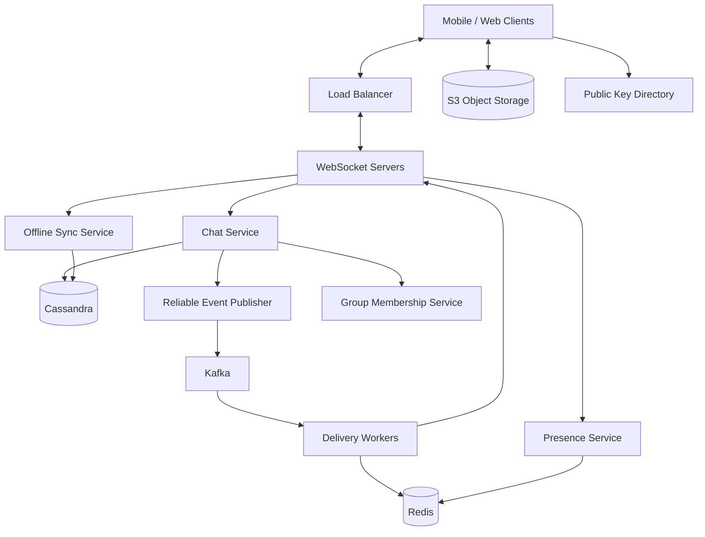
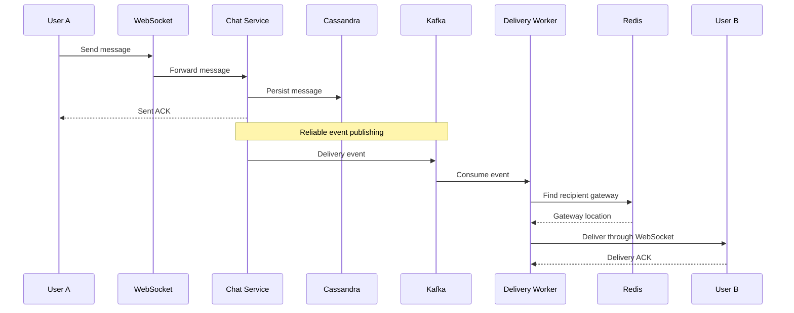
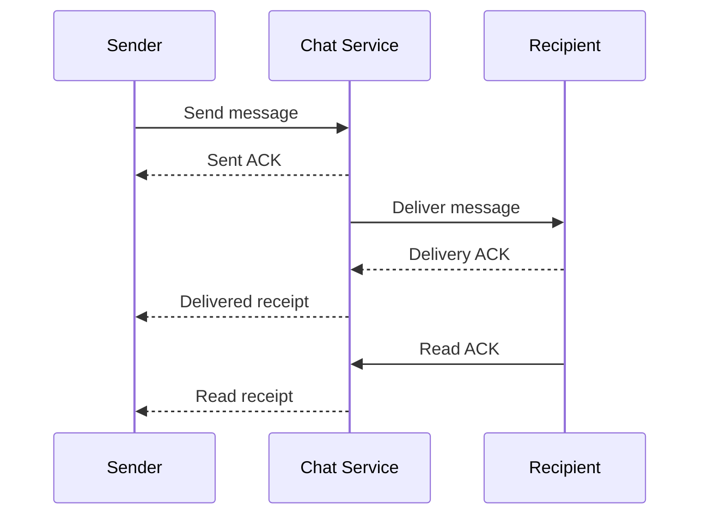
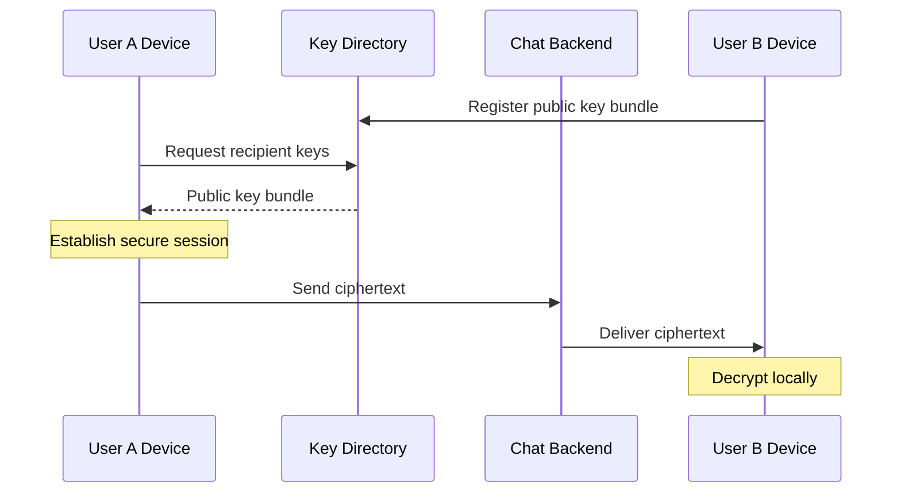

# Design WhatsApp — High-Level System Design Solution

## 1. Overview

Design a highly available, scalable, low-latency messaging system similar to WhatsApp.

The system should support:

- One-to-one messaging
- Group messaging
- Text and image sharing
- Offline message delivery
- Message ordering
- Sent, delivered, and read receipts
- Online/offline presence
- Last-seen timestamps
- End-to-end encryption

**Out of scope:** Voice/video calls, stories, payments, and advanced search.

The numbers below are interview assumptions, not claims about WhatsApp's actual production architecture.

---

## 2. Capacity Estimation

Assume:

| Metric | Estimate |
|---|---|
| Daily Active Users | 100 million |
| Messages per User per Day | 50 |
| Total Messages per Day | 5 billion |
| Average Messages per Second | ~57,870 |
| Peak Messages per Second (5×) | ~289,350 |
| Average Text Message Size | 200 bytes |
| Raw Text Storage per Day | ~1 TB |
| Concurrent WebSocket Connections | 10 million |
| Connections per WebSocket Server | 50,000 |
| Minimum WebSocket Servers | 200 |

### Calculations

**Messages per day**

100 million × 50 = 5 billion messages/day.

**Average throughput**

5 billion / 86,400 ≈ 57,870 messages/second.

**Peak throughput**

57,870 × 5 ≈ 289,350 messages/second.

**Raw text storage**

5 billion × 200 bytes = approximately 1 TB/day.

This excludes message metadata, encryption overhead, media, indexes, replication, and backups.

Group messaging also increases delivery operations because one incoming message may need to reach hundreds of recipients.

---

## 3. High-Level Architecture



### Component Responsibilities

| Component | Responsibility |
|---|---|
| Load Balancer | Distributes new WebSocket connections |
| WebSocket Servers | Maintain persistent client connections |
| Chat Service | Validates, sequences, and stores messages |
| Cassandra | Stores durable message history |
| Kafka | Carries asynchronous delivery events |
| Delivery Workers | Deliver messages and handle group fan-out |
| Redis | Stores active connection mappings and presence |
| Offline Sync Service | Retrieves messages missed while offline |
| Group Membership Service | Manages group members and permissions |
| S3 | Stores encrypted images and media |
| Public Key Directory | Distributes public keys for encrypted sessions |

**Important:** Redis stores the mapping to a WebSocket server, not the actual WebSocket connection.

---

## 4. One-to-One Message Delivery

Suppose User A sends a message to User B.

### Message Flow

1. User A establishes a persistent WebSocket connection.
2. User A sends a message to the Chat Service through the WebSocket Server.
3. The Chat Service authenticates the sender and validates conversation access.
4. It assigns a unique message ID and conversation sequence number.
5. The message is durably stored in Cassandra.
6. A reliable delivery event is published to Kafka.
7. Delivery Workers consume the event.
8. Redis identifies User B's WebSocket Server.
9. If User B is online, the message is delivered immediately.
10. If User B is offline, the message remains in Cassandra for later synchronization.



The sender does not wait for the recipient to receive the message before getting a sent acknowledgment.

---

## 5. Why Cassandra?

We chose Cassandra because our system handles billions of messages daily.

### Advantages

- High write throughput
- Horizontal scalability
- Distributed storage
- Replication and fault tolerance
- Efficient conversation-history retrieval when partition keys are known

### Message Schema

```sql
CREATE TABLE messages_by_conversation (
    conversation_id UUID,
    bucket_date DATE,
    sequence_number BIGINT,
    message_id UUID,
    sender_id UUID,
    message_type TEXT,
    ciphertext BLOB,
    media_object_key TEXT,
    created_at TIMESTAMP,
    PRIMARY KEY (
        (conversation_id, bucket_date),
        sequence_number
    )
) WITH CLUSTERING ORDER BY (
    sequence_number ASC
);
```

### Partition Key

`(conversation_id, bucket_date)`

This allows message history to be distributed into time-based partitions.

### Clustering Key

`sequence_number`

This maintains message ordering within each partition.

### Trade-offs

Cassandra is excellent for high-volume writes but has limitations:

- Cross-partition transactions are difficult.
- Queries must be designed around partition keys.
- Hot conversations can create hot partitions.
- Consistency levels require careful selection.
- Sequence numbers need an external ordering mechanism.

Cassandra replicas improve durability and availability. They are not separate message-history databases.

---

## 6. Message Ordering

Timestamps alone are insufficient for strict ordering.

Problems include:

- Different client clocks
- Network delays
- Concurrent messages
- Retries

Instead, assign a monotonically increasing sequence number per conversation.

Example:

| Sequence | Message |
|---|---|
| 101 | Hello |
| 102 | How are you? |
| 103 | Are you free? |

The client displays messages in sequence-number order.

### Ordering Strategy

- Each conversation has a defined ordering mechanism.
- The Chat Service assigns sequence numbers.
- Messages are persisted with their assigned sequence numbers.
- Clients detect missing sequences and request synchronization.

Kafka events can also use `conversation_id` as the partition key to maintain event order within a partition.

**Important:** Server sequence numbers establish the server-accepted order. Preserving the sender's original order when messages arrive out of order may require client sequence numbers or ordered sender-side processing.

---

## 7. Why Kafka?

Kafka separates message acceptance from message delivery.

Without Kafka, the Chat Service may need to perform delivery work synchronously.

With Kafka:

1. Chat Service stores the message.
2. A delivery event is reliably published.
3. Delivery Workers consume events asynchronously.
4. Delivery Workers route messages to recipients.

### Kafka Benefits

- Asynchronous processing
- Buffering during traffic spikes
- Independent worker scaling
- Retry and replay support
- Group message fan-out
- Reduced coupling between services

### Example Kafka Event

```json
{
  "event_type": "MESSAGE_CREATED",
  "message_id": "msg_101",
  "conversation_id": "chat_123",
  "sender_id": "user_A"
}
```

Kafka is not the permanent message database.

**Cassandra stores message history. Kafka carries delivery events.**

### Kafka Failure Handling

Suppose Kafka is unavailable.

The Chat Service can continue accepting messages only if it can durably record the obligation to publish their delivery events later.

A reliable pending-event mechanism or outbox publisher can replay these events after Kafka recovers.

A traditional transactional outbox requires atomic coordination between the message and outbox record. Cassandra does not automatically provide arbitrary cross-partition ACID transactions, so this mechanism needs careful design.

---

## 8. Kafka Partitions and Consumer Groups

A Kafka topic is divided into partitions.

Partitions allow events to be processed in parallel.

A consumer group contains consumers that share the processing workload.

### Example

20 partitions and 5 consumers:

| Consumer | Partitions |
|---|---|
| Consumer 1 | 0–3 |
| Consumer 2 | 4–7 |
| Consumer 3 | 8–11 |
| Consumer 4 | 12–15 |
| Consumer 5 | 16–19 |

Each consumer processes four partitions, assuming even assignment.

### Important Rules

- One partition is assigned to at most one consumer within a consumer group at a time.
- One consumer may process multiple partitions.
- Adding consumers beyond the partition count does not increase partition-level parallelism.
- Kafka preserves ordering within a partition.
- Duplicate events are possible during retries.

### Scaling Example

If each consumer can process 10,000 events/second, handling 300,000 events/second would require approximately 30 consumers and at least 30 partitions under ideal assumptions.

Real capacity requires benchmarking and headroom.

### Idempotency

Use stable message IDs to prevent duplicate logical messages.

A Delivery Worker or client receiving the same event twice should recognize that the message has already been processed.

---

## 9. WebSocket Architecture

WhatsApp requires persistent, bidirectional communication.

WebSockets allow servers to push messages without clients repeatedly polling.

### Why WebSockets?

- Persistent connections
- Low-latency message delivery
- Bidirectional communication
- Real-time notifications
- Efficient presence updates

### Connection Scaling

Assume:

- 10 million concurrent connections
- 50,000 connections per server

Required servers:

10,000,000 / 50,000 = 200 servers.

At 30 million connections:

30,000,000 / 50,000 = 600 servers.

These are theoretical minimums. Production needs additional failover capacity.

---

## 10. Redis Connection Registry

Suppose:

- User A connects to WebSocket Server 10.
- User B connects to WebSocket Server 150.

Redis stores:

```redis
SET connection:user_A websocket_10 EX 60
SET connection:user_B websocket_150 EX 60
```

The `EX 60` sets a 60-second TTL.

The WebSocket Servers refresh registrations while their connections remain active.

### Message Routing

1. Delivery Worker receives a message event.
2. It queries Redis for the recipient's connection.
3. Redis returns the relevant WebSocket Server.
4. The Delivery Worker forwards the message to that server.
5. The server pushes the message to the client.

### Multi-Device Support

For users with multiple devices, store device-specific connection mappings.

For example:

```text
user_B:phone   → websocket_150
user_B:desktop → websocket_175
```

Connection IDs or generations help prevent stale registrations from overwriting newer ones.

---

## 11. WebSocket Server Failure

Suppose Server 150 crashes.

### Recovery

1. User B's WebSocket connection drops.
2. The client detects the failure using connection errors or heartbeat timeouts.
3. The client reconnects through the load balancer.
4. A healthy server accepts the new connection.
5. The new server registers the connection in Redis.
6. The client retrieves missed messages from Cassandra.

If the old Redis mapping remains temporarily, it expires through TTL or is replaced by the new registration.

The system should not wait for the TTL before attempting reconnection.

### Reliability Principle

**A WebSocket server failure must not cause message loss because the message is already durably stored in Cassandra.**

---

## 12. Offline Message Synchronization

Suppose User B is offline for three days and misses 200 messages.

### Recovery Flow

1. User B reconnects.
2. The client sends its last acknowledged synchronization cursor.
3. The Sync Service retrieves newer messages from Cassandra.
4. Messages are delivered in batches.
5. The client acknowledges successful receipt.
6. The synchronization cursor advances.

### Example

Last acknowledged sequence: 100.

Missed messages: 101–300.

Retrieve 50 messages per batch:

| Batch | Sequence Numbers |
|---|---|
| 1 | 101–150 |
| 2 | 151–200 |
| 3 | 201–250 |
| 4 | 251–300 |

### Cassandra Query

```sql
SELECT *
FROM messages_by_conversation
WHERE conversation_id = ?
  AND bucket_date = ?
  AND sequence_number > ?
LIMIT 50;
```

Because the schema uses date buckets, the service may need to query multiple buckets.

### Important

Offline synchronization reads from Cassandra, not necessarily Kafka.

Kafka triggers asynchronous delivery attempts, while Cassandra retains message history.

For image messages, metadata is synchronized first and media can be downloaded separately.

---

## 13. Group Messaging

Suppose User A sends a message to a group containing 500 members.

### Flow

1. User A sends a message.
2. Chat Service validates group membership.
3. The message is stored once in Cassandra.
4. A delivery event is published to Kafka.
5. Group Delivery Workers retrieve the group membership list.
6. Workers fan out the message to the other 499 members.
7. Online members receive it through WebSocket.
8. Offline members retrieve it later.

### Fan-Out

Fan-out means distributing one message to multiple recipients.

Instead of storing 500 copies of the message body, store one canonical message and maintain recipient-specific delivery progress.

### Large Groups

Very large groups require:

- Parallel delivery workers
- Backpressure
- Batching
- Efficient membership lookups
- Careful handling of hot conversations
- Recipient-specific delivery receipts

---

## 14. Delivery and Read Receipts

WhatsApp-style messaging tracks three main statuses.

| Status | Indicator | Meaning |
|---|---|---|
| Sent | Single gray tick | Server accepted the message |
| Delivered | Double gray tick | Recipient device acknowledged receipt |
| Read | Double blue tick | Recipient reported reading the message |

### Receipt Flow



### Storage

A logical receipt record might contain:

```json
{
  "message_id": "msg_101",
  "recipient_id": "user_B",
  "status": "READ",
  "delivered_at": "2026-11-07T10:30:02Z",
  "read_at": "2026-11-07T10:30:10Z"
}
```

For groups, each recipient has independent receipt state.

Receipts should be idempotent and should not regress from READ to DELIVERED.

Read-receipt privacy settings must also be respected.

---

## 15. Image and Media Messaging

Large media files should not be stored directly in Cassandra.

Use S3-compatible object storage.

### Image Upload Flow

1. User A selects a 10 MB image.
2. The client requests an authorized upload URL.
3. The client encrypts the image locally.
4. The encrypted image is uploaded directly to object storage.
5. The backend verifies upload completion.
6. The Chat Service stores a message with the media reference in Cassandra.
7. Kafka triggers delivery.
8. User B receives a notification.
9. User B securely downloads and decrypts the image.

### Example Metadata

```json
{
  "message_id": "msg_201",
  "conversation_id": "chat_123",
  "message_type": "IMAGE",
  "media_object_key": "chat-media/img_201",
  "sender_id": "user_A"
}
```

### Benefits

- Independent media scaling
- Reduced database load
- Direct uploads and downloads
- CDN integration
- Better handling of large files

Use private buckets, short-lived URLs, access checks, and retention policies.

---

## 16. End-to-End Encryption

End-to-end encryption ensures only intended recipient devices can decrypt message contents.

### Key Concepts

Each device generates cryptographic key material.

- **Public keys:** Shared through a key directory.
- **Private keys:** Remain securely on the device.

### Message Flow

1. User B registers a public-key bundle.
2. User A retrieves User B's public-key bundle.
3. User A's device establishes a secure session.
4. User A encrypts the message locally.
5. The Chat Service receives ciphertext.
6. Cassandra stores ciphertext.
7. The encrypted message is delivered.
8. User B decrypts it locally.



A production implementation should use a proven protocol such as Signal Protocol rather than custom cryptography.

Additional concerns include:

- Identity verification
- Key rotation
- Forward secrecy
- Multi-device support
- Group key management
- Secure media-key distribution

End-to-end encryption protects content, but the backend may still see routing and other metadata.

---

## 17. Online/Offline Presence

We use WebSockets and Redis to track online users.

### User Comes Online

1. User establishes a WebSocket connection.
2. WebSocket Server registers the connection in Redis.
3. Presence Service marks the user online.
4. Heartbeats periodically refresh the presence entry.

Example:

```redis
SET presence:user_B online EX 60
```

### User Goes Offline

On normal disconnect, the server removes or updates the presence registration.

On unexpected failure, the Redis entry eventually expires.

For multiple devices, the user should remain online if at least one authorized device is connected.

### Presence Lookup

When User A opens User B's chat:

1. Presence Service checks Redis.
2. If User B is connected, it may return ONLINE.
3. Otherwise, it returns OFFLINE or last-seen information, subject to privacy settings.

---

## 18. Last-Seen Timestamp

Redis presence entries expire, so persistent last-seen information is stored separately.

We can use Cassandra.

Example:

```json
{
  "user_id": "user_B",
  "last_seen_at": "2026-11-07T22:30:00Z"
}
```

### Flow

1. User B disconnects.
2. Presence Service records the last-seen timestamp.
3. Cassandra stores the timestamp.
4. User A requests User B's status.
5. Presence Service checks Redis.
6. If offline, it retrieves the last-seen timestamp from Cassandra.

If a server crashes, the last successful heartbeat can be used to estimate the last-seen time.

Updates should avoid overwriting newer timestamps with older values.

---

## 19. Horizontal Scaling

### WebSocket Scaling

Add more WebSocket Servers behind a load balancer.

Existing connections remain on their current servers while new connections are routed to healthy servers.

### Load Balancing

For long-lived WebSocket connections, a least-connections or capacity-aware strategy is often preferable to simple round-robin.

Consider:

- Active connections
- CPU utilization
- Memory utilization
- Network throughput
- Health checks
- Maximum connection capacity

### Kafka Scaling

Increase partitions and consumers to improve parallel processing.

Monitor consumer lag and delivery-worker capacity.

### Cassandra Scaling

Add nodes to distribute storage and throughput.

Monitor partition sizes, write latency, replication health, and hot partitions.

### Redis Scaling

Use sharding or clustering as connection-registry volume increases.

---

## 20. Fault Tolerance and Failure Recovery

| Failure | Recovery Strategy |
|---|---|
| WebSocket server crash | Reconnect and synchronize missed messages |
| Redis entry becomes stale | TTL expiration and connection registration replacement |
| Kafka unavailable | Retain pending events and publish after recovery |
| Duplicate Kafka event | Deduplicate using message ID |
| Cassandra node failure | Replication and appropriate consistency settings |
| Recipient offline | Retrieve missed messages from Cassandra |
| Media upload interruption | Retry or resume upload |
| Group fan-out spike | Kafka buffering, worker scaling, backpressure |
| Message sequence gap | Retrieve missing history from Cassandra |

### Monitoring

Track:

- Message send acknowledgment latency
- End-to-end delivery latency
- WebSocket connection count
- Connection failures and reconnects
- Kafka consumer lag
- Cassandra write failures
- Redis lookup failures
- Offline synchronization latency
- Delivery retry and deduplication rates
- Pending-event backlog

---

## 21. Key Design Trade-offs

| Technology | Advantages | Trade-offs |
|---|---|---|
| WebSockets | Real-time bidirectional messaging | Long-lived connection management |
| Cassandra | High write scalability | Query-oriented schema and consistency complexity |
| Kafka | Asynchronous delivery and buffering | Consumer lag and duplicate processing |
| Redis | Fast connection lookups | Stale mappings and TTL handling |
| S3 | Scalable media storage | Separate upload/download lifecycle |
| Sequence Numbers | Consistent conversation order | Sequencer coordination |
| End-to-End Encryption | Strong message privacy | Complex key management |

---

## 22. Final Interview Explanation

If an interviewer asks me to explain my WhatsApp architecture in approximately two minutes:

> I would design WhatsApp using persistent WebSocket connections behind a load balancer for low-latency bidirectional communication.
>
> When a user sends a message, the Chat Service authenticates the sender, validates conversation membership, assigns a unique message ID and per-conversation sequence number, and durably stores the encrypted message in Cassandra.
>
> A reliable event-publishing mechanism sends a delivery event to Kafka. Delivery Workers consume the event, check Redis to locate the recipient's WebSocket server, and deliver the message if the recipient is online.
>
> If the recipient is offline, the message remains in Cassandra. When the recipient reconnects, the Offline Sync Service retrieves missed messages using the last acknowledged sequence number and delivers them in batches.
>
> For group messaging, we store one canonical message and use Kafka-backed workers to fan out delivery to group members.
>
> For image messaging, we use S3-compatible object storage and keep only media references in Cassandra.
>
> Redis tracks active connections and presence using TTL-based registrations, while Cassandra stores persistent last-seen information.
>
> We scale WebSocket servers, Kafka consumers, and Cassandra independently. We handle failures through reconnection, replication, retries, idempotency, and durable event recovery.
>
> Finally, end-to-end encryption ensures that message contents are encrypted on sender devices and decrypted only on intended recipient devices.

---

## 23. Important Follow-Up Interview Questions

1. How would you prevent duplicate messages if Kafka retries an event?
2. How would you guarantee message ordering across multiple Chat Service instances?
3. How would you handle a group with 100,000 members?
4. How would you manage multiple devices for the same user?
5. What happens when Kafka is unavailable?
6. How would you prevent hot Cassandra partitions?
7. How would you handle message deletion and retention?
8. How would you securely manage encryption keys for group conversations?
9. How would you scale to 100 million concurrent WebSocket connections?
10. How would you measure and improve message delivery latency?

---

## Conclusion

The proposed WhatsApp architecture combines:

- **WebSockets** for real-time communication
- **Cassandra** for durable message history
- **Kafka** for asynchronous delivery
- **Redis** for connection routing and presence
- **S3** for encrypted media storage
- **Sequence numbers** for conversation ordering
- **Acknowledgments** for delivery tracking
- **End-to-end encryption** for message privacy

The design prioritizes scalability, availability, durability, low latency, and fault tolerance while allowing each major component to scale independently.

---

**Repository:** `02-Design-WhatsApp/`

**README.md:** Problem statement and requirements.

**SOLUTION.md:** Complete architecture, design decisions, calculations, and trade-offs.
