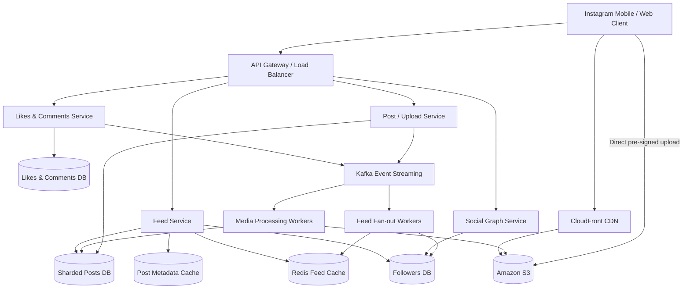
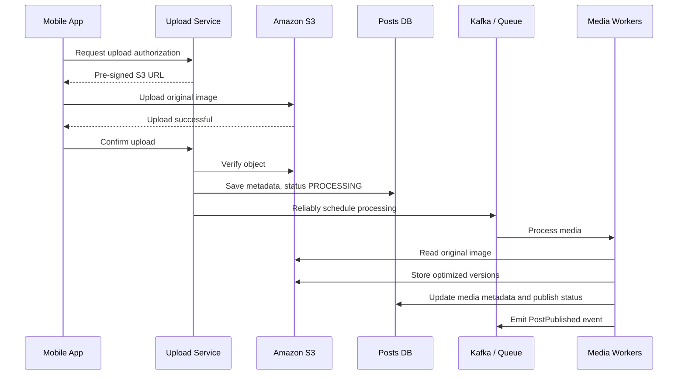
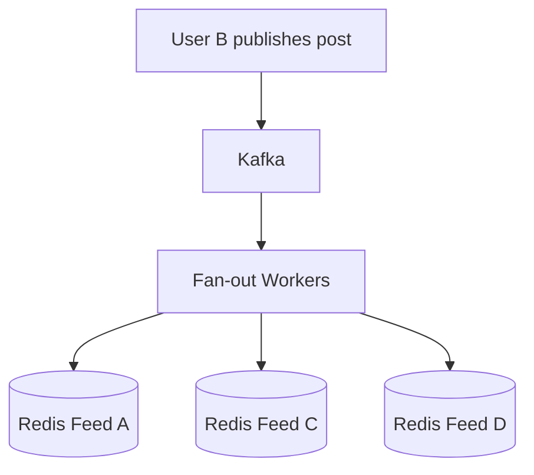
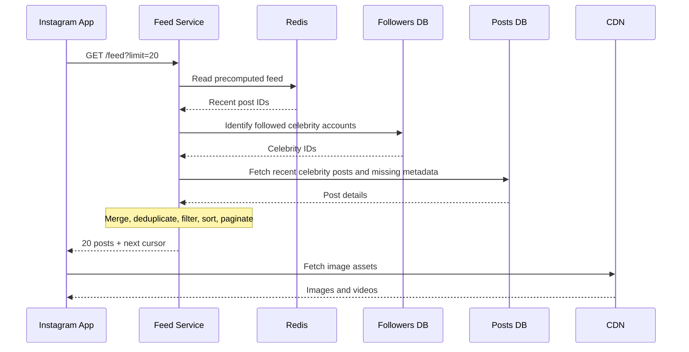
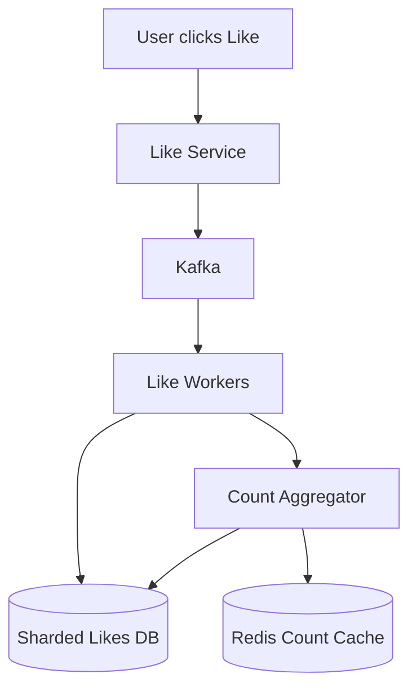

# Design Instagram — Complete High-Level System Design Solution

## 1. Overview

Instagram is a large-scale social media platform that allows users to publish photos and videos, follow other users, like and comment on posts, and browse personalized home feeds.

The primary challenges are:

- Handling millions of media uploads efficiently.
- Generating personalized feeds for millions of active users.
- Serving images and videos with low latency.
- Managing accounts with millions of followers.
- Scaling post metadata, follow relationships, likes, and comments.
- Maintaining availability and recovering from partial failures.
- Supporting infinite scrolling without duplicate or skipped posts.

This solution uses a **hybrid feed-generation architecture**, asynchronous event processing, object storage, distributed caching, and horizontally scalable databases.

The design is illustrative rather than a description of Instagram's actual internal infrastructure.

---

# 2. Requirements

## 2.1 Functional Requirements

1. Users can upload photos and videos with captions.
2. Users can view their own posts and other users' profiles.
3. Users can follow and unfollow accounts.
4. Users can view a personalized home feed.
5. Users can like and unlike posts.
6. Users can comment on posts.
7. Users can search for other users.
8. Users can scroll through feeds using pagination.

### Out of Scope

- Stories
- Direct messaging
- Live streaming
- Advertising
- Advanced ML-based feed ranking
- Reels recommendation systems

For simplicity, the home feed is ordered in reverse chronological order.

## 2.2 Non-Functional Requirements

| Requirement | Design Goal |
|---|---|
| Availability | Remain operational during individual component failures |
| Feed latency | Target p95 under 200 ms for metadata API responses under normal operating conditions |
| Durability | Successfully committed media and metadata must survive infrastructure failures |
| Scalability | Support 100M daily active users and horizontal growth |
| Reliability | Support retries, idempotency, and recovery |
| Consistency | Eventual consistency for feed updates and engagement counts |
| Security | Authenticate users and enforce media visibility |
| Cost efficiency | Avoid unnecessary media transfers and database writes |

The latency target is a design objective, not a measured result. Actual image rendering time depends on network conditions, image size, and CDN performance.

---

# 3. Capacity Estimation

## 3.1 Assumptions

| Metric | Value |
|---|---|
| Daily active users | 100 million |
| New posts per day | 10 million |
| Feed requests per user per day | 50 |
| Average photo size | 2 MB |
| Posts returned per feed request | 20 |
| Peak multiplier | 5× |
| Seconds per day | 86,400 |

For initial media-storage calculations, assume every post contains one photo. Videos, thumbnails, replicas, and other derived assets are additional.

## 3.2 Post Upload QPS

Average:

```text
10,000,000 / 86,400
≈ 116 uploads/second
```

Peak:

```text
116 × 5
≈ 580 uploads/second
```

## 3.3 Home Feed QPS

Total feed requests per day:

```text
100,000,000 × 50
= 5,000,000,000 requests/day
```

Average:

```text
5,000,000,000 / 86,400
≈ 57,870 requests/second
```

Peak:

```text
57,870 × 5
≈ 289,350 requests/second
```

The feed is significantly more read-heavy than the post-upload path.

## 3.4 Photo Storage

Daily raw photo storage:

```text
10,000,000 × 2 MB
= 20,000,000 MB
≈ 20 TB/day
```

Annual raw photo storage:

```text
20 TB × 365
≈ 7.3 PB/year
```

This uses decimal units.

Real storage requirements will be higher due to:

- Videos
- Multiple image resolutions
- Thumbnails
- Transcoded media
- Replication and backup
- Metadata
- Temporary upload files

## 3.5 Post Metadata Storage

Assume 1 KB of metadata per post.

```text
10,000,000 × 1 KB
≈ 10 GB/day

10 GB × 365
≈ 3.65 TB/year
```

This excludes indexes, database replication, follower relationships, likes, and comments.

## 3.6 Feed Metadata Throughput

At 20 posts per feed request:

```text
57,870 × 20
≈ 1.16 million post entries/second
```

At 5× peak:

```text
≈ 5.79 million post entries/second
```

These are logical post entries returned, not necessarily database reads. Redis and metadata caching should absorb much of the repeated access.

## 3.7 Media Delivery Bandwidth

Assume each feed request ultimately causes 20 full 2 MB images to be transferred, with no browser cache hits.

```text
57,870 × 20 × 2 MB
≈ 2,314,800 MB/second
≈ 2.31 TB/second
```

This is a deliberately conservative upper-bound workload assumption, not a realistic measured average.

In practice, bandwidth is reduced by:

- Smaller feed thumbnails
- Lazy loading
- Client caching
- Adaptive image resolutions
- Compression
- Not every feed item being viewed
- Video streaming behavior

The CDN must be designed and capacity-planned separately from the feed metadata API.

---

# 4. High-Level Architecture



### Main Components

**API Gateway**

Handles routing, authentication integration, request validation, and rate limiting.

**Post Service**

Manages post creation, upload authorization, metadata, and publication lifecycle.

**Media Processing Workers**

Generate optimized images, thumbnails, and transcoded videos.

**Social Graph Service**

Manages follow relationships and follower queries.

**Feed Service**

Generates personalized feeds using cached and dynamically fetched posts.

**Kafka**

Connects services through durable asynchronous events.

**Redis**

Stores precomputed feeds, frequently accessed metadata, and engagement counters.

**S3**

Stores original and processed media objects.

**CDN**

Delivers images and videos to users with low latency.

---

# 5. Database Design

## 5.1 Users Table

```sql
CREATE TABLE users (
    user_id BIGINT PRIMARY KEY,
    username VARCHAR(50) UNIQUE NOT NULL,
    display_name VARCHAR(100),
    profile_image_key TEXT,
    created_at TIMESTAMP NOT NULL
);
```

## 5.2 Posts Table

```sql
CREATE TABLE posts (
    post_id BIGINT PRIMARY KEY,
    user_id BIGINT NOT NULL,
    caption TEXT,
    original_media_key TEXT,
    status VARCHAR(20) NOT NULL,
    created_at TIMESTAMP NOT NULL
);
```

Possible statuses:

```text
PENDING_UPLOAD
PROCESSING
PUBLISHED
FAILED
DELETED
```

A production implementation may use a separate media-assets table to support multiple images and videos per post.

Recommended index:

```sql
CREATE INDEX idx_posts_user_created
ON posts(user_id, created_at DESC, post_id DESC);
```

This supports efficient profile-post queries.

## 5.3 Follows Table

```sql
CREATE TABLE follows (
    follower_id BIGINT NOT NULL,
    following_id BIGINT NOT NULL,
    created_at TIMESTAMP NOT NULL,
    PRIMARY KEY (follower_id, following_id)
);
```

Recommended reverse index:

```sql
CREATE INDEX idx_follows_following
ON follows(following_id, follower_id);
```

The primary key helps retrieve accounts a user follows.

The reverse index helps retrieve followers of an author for fan-out processing.

## 5.4 Likes Table

```sql
CREATE TABLE likes (
    user_id BIGINT NOT NULL,
    post_id BIGINT NOT NULL,
    created_at TIMESTAMP NOT NULL,
    PRIMARY KEY (user_id, post_id)
);
```

The composite primary key prevents duplicate like relationships.

At scale, likes may be partitioned by post ID or another strategy chosen to balance write distribution and query requirements.

## 5.5 Comments Table

```sql
CREATE TABLE comments (
    comment_id BIGINT PRIMARY KEY,
    post_id BIGINT NOT NULL,
    user_id BIGINT NOT NULL,
    content TEXT NOT NULL,
    created_at TIMESTAMP NOT NULL
);
```

Recommended index:

```sql
CREATE INDEX idx_comments_post_created
ON comments(post_id, created_at DESC, comment_id DESC);
```

This supports retrieving recent comments for a post.

---

# 6. Media Upload Architecture

## 6.1 Why Use S3?

Images and videos are large binary objects.

Storing them directly inside the Posts Database increases database size, replication overhead, backup costs, and serving complexity.

Instead:

- S3 stores media bytes.
- The database stores media references and metadata.
- A CDN handles media delivery.

Example:

```json
{
  "post_id": "P101",
  "user_id": "A",
  "caption": "Beautiful sunset!",
  "image_key": "posts/A/P101/original.jpg",
  "status": "PUBLISHED"
}
```

## 6.2 Why Use Pre-Signed URLs?

Without pre-signed URLs:

```text
Client → API Gateway → Upload Service → S3
```

Every image passes through application servers.

With pre-signed URLs:

```text
Client → Upload Service: Request upload URL
Upload Service → Client: Signed URL
Client → S3: Upload media directly
```

Benefits:

- Reduced backend bandwidth
- Lower application-server resource usage
- Independent media upload scaling
- Short-lived, scoped upload permissions
- No AWS credentials exposed to clients

The service should validate the authenticated user, allowed media type, expected size, upload ownership, and object key. A pre-signed URL alone is not a complete file-validation mechanism.

## 6.3 Complete Upload Sequence



The diagram represents the logical workflow. Production code should use a transactional outbox or an equivalent mechanism to avoid losing events between database commits and message publication.

## 6.4 Image Processing

Workers can:

1. Validate image contents.
2. Resize images.
3. Compress images.
4. Generate thumbnails.
5. Convert images into supported optimized formats.
6. Store derived images in S3.
7. Update media metadata.

For videos, workers can also:

- Transcode into multiple resolutions.
- Generate preview thumbnails.
- Package adaptive streaming formats.
- Extract duration and dimensions.

## 6.5 Upload Failure Handling

**Client upload fails**

The client retries with a valid upload URL or requests a new one.

**URL expires**

The client requests another pre-signed URL.

**Worker crashes**

The processing task is retried.

**Processing repeatedly fails**

Mark the post `FAILED`, retain diagnostic information, and provide a retry or recovery mechanism.

**Upload is abandoned**

A cleanup process removes expired temporary objects and incomplete upload records.

**Duplicate completion requests**

Use the upload ID and post state to make completion idempotent.

---

# 7. Home Feed Architecture

## 7.1 Basic Feed Generation

Suppose User A follows B, C, and D.

The basic flow is:

1. Retrieve the accounts User A follows.
2. Retrieve recent published posts from those accounts.
3. Sort posts by creation time.
4. Return the latest 20.

Example SQL:

```sql
SELECT p.*
FROM posts p
JOIN follows f
  ON p.user_id = f.following_id
WHERE f.follower_id = :user_id
  AND p.status = 'PUBLISHED'
ORDER BY p.created_at DESC, p.post_id DESC
LIMIT 20;
```

This is a reasonable starting design, but it becomes expensive as the number of users, follows, and posts increases.

For a distributed database, this query may require multiple shard queries or a materialized feed index.

---

# 8. Fan-out on Write vs. Fan-out on Read

## 8.1 Fan-out on Write (Push Model)

When an author publishes a post, the system distributes its post ID into followers' feeds.



### Advantages

- Fast feed reads
- Feeds are largely precomputed
- Good for normal accounts with manageable follower counts

### Disadvantages

- Higher write amplification
- Significant work when popular accounts publish
- Feed caches require storage and maintenance

## 8.2 Fan-out on Read (Pull Model)

When an author publishes a post, the system stores it without pushing it to every follower.

When someone opens their feed, recent posts are retrieved from followed accounts.

### Advantages

- Lower publication-time fan-out cost
- Suitable for celebrity accounts
- Avoids millions of immediate feed updates

### Disadvantages

- More work during feed retrieval
- May increase feed latency
- Requires efficient indexes and caching

## 8.3 Hybrid Fan-out Strategy

Use both strategies.

| Author Type | Strategy |
|---|---|
| Regular user with 500 followers | Fan-out on Write |
| Popular user with thousands of followers | Depends on workload |
| Celebrity with 20M followers | Fan-out on Read |

For regular accounts, asynchronously distribute post IDs to followers' Redis feeds.

For celebrities, cache their recent post lists and merge those posts into followers' feeds at read time.

The celebrity threshold should be based on measured fan-out cost, follower activity, and infrastructure capacity rather than a universal follower-count rule.

---

# 9. Kafka and Asynchronous Feed Updates

## 9.1 Why Kafka?

Without Kafka, the Post Service might synchronously update hundreds or millions of followers' feeds.

That creates:

- Higher publication latency
- Tight coupling between services
- Failure propagation
- Difficulty absorbing traffic spikes

With Kafka:

```text
Post Service
    ↓
PostPublished Event
    ↓
Kafka
    ↓
Feed Fan-out Workers
    ↓
Followers Database
    ↓
Redis Feeds
```

The post-publication API does not need to wait for every follower's feed to be updated.

## 9.2 Example Event

```json
{
  "event_id": "evt_101",
  "event_type": "PostPublished",
  "post_id": "P101",
  "author_id": "B",
  "created_at": 1794400000
}
```

Workers consume the event and update eligible followers' feeds.

## 9.3 Reliable Event Publishing

Consider this failure:

1. The Posts Database successfully commits a published post.
2. The Post Service crashes before publishing the Kafka event.

The post exists, but followers may never receive the feed update.

A **transactional outbox** solves this problem.

Within the same database transaction:

- Update the post to `PUBLISHED`.
- Insert a `PostPublished` event into an outbox table.

An outbox publisher then delivers the event to Kafka and marks it delivered.

Delivery may occur more than once, so consumers must remain idempotent.

---

# 10. Redis Feed Caching

## 10.1 Why Redis?

The feed is read frequently.

Repeatedly querying follow relationships and post metadata for every feed request would create heavy database load.

Redis provides fast in-memory access to precomputed feed entries.

## 10.2 Redis Sorted Sets

Use a Sorted Set for each user.

Key:

```text
feed:user_A
```

Members:

```text
P103
P102
P101
```

Scores:

```text
Post creation timestamps
```

Example:

```redis
ZADD feed:user_A 1794400000 P101
```

Read the latest 20 posts:

```redis
ZREVRANGE feed:user_A 0 19
```

Redis orders the members by numeric score.

## 10.3 Why Sorted Sets Prevent Duplicates

Suppose a Kafka worker adds `P101`:

```redis
ZADD feed:user_A 1794400000 P101
```

The worker crashes and retries:

```redis
ZADD feed:user_A 1794400000 P101
```

Redis does not create a second `P101` entry.

A Sorted Set contains unique members. Repeating the same operation updates the existing member's score.

This makes repeated feed insertions idempotent.

For deterministic ordering when timestamps are equal, the application should define a consistent secondary ordering rule, such as a post ID, and ensure the feed index supports it.

## 10.4 Redis TTL

TTL controls how long a cached feed key remains in Redis.

Post timestamps control ordering.

These are different concepts.

A feed cache can also be bounded to a fixed number of recent posts to control memory usage.

Older posts can be retrieved from persistent storage when necessary.

## 10.5 Redis Failure Recovery

If Redis loses User A's cached feed:

1. The Feed Service detects the missing or unavailable cache.
2. It retrieves User A's follow relationships.
3. It queries recent posts from the followed accounts.
4. It reconstructs the feed.
5. It returns the requested page.
6. It repopulates Redis asynchronously.

This is a cache-aside recovery strategy.

For large outages, the service should limit fallback concurrency and use gradual cache warming to avoid overwhelming databases.

Redis replication and failover can reduce downtime, but persistent databases remain the authoritative source of post and relationship data.

---

# 11. Complete Feed Retrieval Flow



### Feed Retrieval Steps

1. Client requests the home feed.
2. Feed Service reads precomputed post IDs from Redis.
3. It retrieves recent posts from followed celebrity accounts.
4. It merges both sets.
5. It removes duplicates.
6. It checks post visibility and follow eligibility.
7. It sorts posts by timestamp and ID.
8. It returns 20 posts and a pagination cursor.
9. The client downloads media through the CDN.

For large-scale production systems, celebrity-post retrieval should use cached recent-post indexes or batch queries rather than issuing an expensive query for every celebrity on each request.

---

# 12. CDN and Media Delivery

## 12.1 Why a CDN?

A CDN caches media near users, reducing:

- Network latency
- Repeated S3 requests
- Origin bandwidth
- Load on application infrastructure

Typical delivery flow:

```text
Instagram App
    ↓
CloudFront CDN
    ↓ Cache miss
Amazon S3
```

The first request may reach S3.

Subsequent requests can be served from CDN edge caches.

## 12.2 Redis vs. CDN

| Redis | CDN |
|---|---|
| Caches feed post IDs | Caches images/videos |
| Caches post metadata | Delivers media bytes |
| Supports personalized feed retrieval | Accelerates content delivery |
| Used by backend services | Accessed by mobile/web clients |

If Redis crashes, the CDN may still have images, but it cannot normally reconstruct User A's personalized feed.

## 12.3 Media Security

For public posts, the CDN can serve cacheable media through controlled origin access.

For private accounts and restricted content, the system must enforce authorization and use appropriate signed URLs, signed cookies, or another access-controlled delivery mechanism.

Deleting a post may also require CDN invalidation or short-lived access policies to prevent continued unauthorized delivery.

---

# 13. Database Sharding

## 13.1 Why Shard?

A single database eventually becomes constrained by:

- Storage
- CPU
- Memory
- Network bandwidth
- Query throughput

Sharding distributes data across multiple database partitions.

## 13.2 Sharding Posts by User ID

A useful starting strategy is:

```text
shard = hash(user_id) % number_of_shards
```

Example:

```text
Shard 1 → Users A, D
Shard 2 → Users B, E
Shard 3 → Users C, F
```

All posts from a user are stored together.

### Advantages

- Efficient user-profile post retrieval
- Convenient author-based queries
- Good locality for posts belonging to one account

### Disadvantages

- Celebrity accounts may create hot partitions
- Post-ID-only lookups require shard routing
- Resharding must be planned carefully

In production, consistent hashing or a shard-directory service is preferable to relying on a fixed modulo scheme during cluster growth.

## 13.3 Sharding by Post ID

An alternative is distributing posts by post ID.

Advantages:

- Individual post lookups can route efficiently.
- A single author's posts may be spread across shards.

Disadvantages:

- Retrieving all posts for one author may require multiple shard queries.
- Additional author-to-post indexes may be needed.

## 13.4 Handling Celebrity Hot Shards

Suppose a celebrity has 100 million followers.

Millions of users may request that celebrity's posts.

If all those posts live on one shard, that shard can become overloaded.

Solutions:

1. Cache popular post metadata in Redis.
2. Use read replicas.
3. Cache recent posts for celebrity accounts.
4. Use fan-out on read to avoid massive feed-write amplification.
5. Introduce additional partitioning or hot-key mitigation when necessary.

Fan-out on read does not automatically eliminate hot-shard problems. It reduces fan-out writes, while caching and replicas help distribute read load.

---

# 14. Likes Architecture

## 14.1 The Viral Post Problem

Suppose a celebrity receives:

```text
1,000,000 likes/minute
```

That is:

```text
1,000,000 / 60
≈ 16,667 likes/second
```

Updating a single post's like-count row for every request can create severe contention.

## 14.2 Architecture



## 14.3 Like Processing

1. User sends a Like request.
2. Like Service authenticates the user and validates the post.
3. A durable like command is recorded or published.
4. Workers process the command idempotently.
5. The Likes Database records the unique `(user_id, post_id)` relationship.
6. Accepted like/unlike changes are aggregated.
7. Redis caches the latest count.
8. Aggregate counts are periodically persisted.

A reliable design should not increment the count for a duplicate event or a like that already exists.

For high concurrency, counter aggregation can use partitioned counters and periodic consolidation rather than updating a single database row per event.

## 14.4 Duplicate Prevention

The Likes Database enforces:

```sql
PRIMARY KEY (user_id, post_id)
```

Repeated like requests should not create multiple relationships.

Like and unlike commands also need ordering or versioning safeguards to prevent delayed events from incorrectly restoring an older state.

## 14.5 Consistency

The user's own like status should be handled consistently enough that the UI does not repeatedly flip between states.

The public like count may be eventually consistent.

This allows the system to prioritize low-latency reads and high write throughput.

---

# 15. Comments Architecture

Comments are stored in a database partitioned or indexed by post ID.

A basic flow:

```text
Client
   ↓
Comment Service
   ↓
Comments Database
   ↓
Cache invalidation / update
```

For popular posts:

- Use cursor-based pagination for comments.
- Index by post ID and creation time.
- Cache recent comments where useful.
- Rate-limit abusive or excessive requests.
- Use asynchronous events for notifications and analytics.

Comments should have durable writes and stable IDs so retries do not create duplicates.

---

# 16. Cursor-Based Pagination

## 16.1 Why Pagination?

A user may follow hundreds of accounts with thousands of posts.

Returning every post in one request would increase:

- Latency
- Network bandwidth
- Memory consumption
- Backend processing

Instead, return a small page, such as 20 posts.

## 16.2 OFFSET Pagination Problem

Suppose page 1 returns:

```text
P10, P9, P8, P7, P6
```

Then a new post `P11` arrives.

The order becomes:

```text
P11, P10, P9, P8, P7, P6, P5...
```

An `OFFSET 5` query now starts at `P6`.

But the user already saw `P6`.

This creates a duplicate.

## 16.3 Cursor-Based Pagination

Instead of skipping rows, continue after the last post already returned.

Page 1:

```text
P10, P9, P8, P7, P6
```

Cursor:

```text
P6
```

Page 2:

```text
P5, P4, P3, P2, P1
```

New posts are fetched when the user refreshes the feed.

## 16.4 SQL Example

```sql
SELECT *
FROM feed_entries
WHERE user_id = :user_id
  AND (created_at, post_id) < (:last_timestamp, :last_post_id)
ORDER BY created_at DESC, post_id DESC
LIMIT 20;
```

This assumes a chronological feed with a suitable index.

The cursor should encode both timestamp and post ID to provide deterministic ordering when timestamps are equal.

## 16.5 API Example

First request:

```http
GET /api/v1/feed?limit=20
```

Response:

```json
{
  "posts": ["P10", "P9", "P8", "P7", "P6"],
  "next_cursor": "opaque_cursor_value"
}
```

Next request:

```http
GET /api/v1/feed?limit=20&cursor=opaque_cursor_value
```

A production cursor should be opaque to clients and can encode the ordering position and feed-version information.

For a hybrid feed, stable pagination may require a feed snapshot or pagination session to avoid duplicates and omissions when multiple data sources change.

---

# 17. Failure Handling

| Failure | Recovery Strategy |
|---|---|
| Upload interrupted | Retry upload or restart with a new URL |
| Upload URL expired | Generate a new pre-signed URL |
| Media worker crashes | Retry queued processing job |
| Post saved but Kafka event not published | Transactional outbox |
| Fan-out worker crashes | Retry uncommitted work |
| Duplicate Kafka event | Idempotent Redis and database operations |
| Redis feed cache lost | Reconstruct from persistent post and follow data |
| Redis unavailable | Failover and bounded database fallback |
| Posts shard overloaded | Cache, replicas, repartitioning |
| Viral like spike | Sharded likes, batching, partitioned counters |
| CDN cache miss | Fetch media from S3 |
| Post deleted | Remove from feed eligibility and invalidate affected caches |
| User unfollows an account | Filter unauthorized or unfollowed content at read time |

## 17.1 Kafka Worker Crash Example

Suppose User B has 500 followers.

A worker updates 250 feeds and crashes.

On retry:

1. Kafka redelivers the uncommitted event.
2. The worker processes the followers again.
3. Redis Sorted Sets prevent duplicate post IDs.
4. Remaining followers receive the post.
5. The worker commits its Kafka offset after successful processing.

For large follower counts, split work into independently retryable batches.

## 17.2 Redis Failure Example

If User A's Redis feed disappears:

1. Feed Service detects the cache miss.
2. It retrieves User A's follow relationships.
3. It retrieves recent posts from persistent storage.
4. It rebuilds the feed.
5. It returns a page to the user.
6. Redis is repopulated asynchronously.

Redis is a performance optimization, not the only permanent source of feed information.

---

# 18. API Design

## 18.1 Initiate Upload

```http
POST /api/v1/media/upload-url
```

Request:

```json
{
  "file_name": "sunset.jpg",
  "content_type": "image/jpeg",
  "file_size": 5242880
}
```

Response:

```json
{
  "upload_id": "upload_123",
  "upload_url": "https://example-s3-signed-url",
  "object_key": "uploads/A/upload_123.jpg",
  "expires_in": 600
}
```

## 18.2 Complete Upload

```http
POST /api/v1/media/complete
```

Request:

```json
{
  "upload_id": "upload_123"
}
```

Response:

```json
{
  "upload_id": "upload_123",
  "status": "PROCESSING"
}
```

## 18.3 Create Post

```http
POST /api/v1/posts
```

Request:

```json
{
  "upload_id": "upload_123",
  "caption": "Beautiful sunset!"
}
```

Response:

```json
{
  "post_id": "P101",
  "status": "PROCESSING"
}
```

The post becomes publicly visible only after processing and publication checks succeed.

## 18.4 Get Home Feed

```http
GET /api/v1/feed?limit=20&cursor=...
```

Response:

```json
{
  "posts": [
    {
      "post_id": "P101",
      "author_id": "B",
      "caption": "Beautiful sunset!",
      "media_url": "https://cdn.example.com/posts/P101/image.jpg",
      "created_at": "2026-11-11T12:00:00Z"
    }
  ],
  "next_cursor": "opaque_cursor_value"
}
```

## 18.5 Follow User

```http
POST /api/v1/users/B/follow
```

## 18.6 Unfollow User

```http
DELETE /api/v1/users/B/follow
```

## 18.7 Like Post

```http
POST /api/v1/posts/P101/likes
```

## 18.8 Unlike Post

```http
DELETE /api/v1/posts/P101/likes
```

## 18.9 Add Comment

```http
POST /api/v1/posts/P101/comments
```

Request:

```json
{
  "content": "Amazing photo!"
}
```

All state-changing endpoints should authenticate the user, validate authorization, apply appropriate rate limits, and support safe retry behavior.

---

# 19. Security and Privacy

Although advanced privacy features are not the primary focus, basic security is essential.

## Authentication

Use authenticated sessions or access tokens.

The API Gateway and services validate user identity.

## Authorization

Verify that users can access a post before returning protected content.

## Private Accounts

Only approved followers should access private posts.

## Upload Security

- Use short-lived pre-signed URLs.
- Validate media type and size.
- Verify uploaded objects.
- Scan or validate uploaded content as appropriate.
- Prevent unauthorized object overwrites.

## CDN Security

Use controlled origin access and signed delivery mechanisms for restricted content.

## Abuse Protection

Apply rate limits to uploads, likes, comments, follows, and searches.

## Deletion

When a post is deleted:

1. Mark it unavailable in persistent metadata.
2. Prevent it from appearing in feeds.
3. Invalidate relevant caches.
4. Revoke or expire access to restricted media.
5. Remove underlying objects according to retention policy.

---

# 20. Monitoring and Observability

Important metrics include:

| Area | Metrics |
|---|---|
| Feed Service | p50/p95/p99 latency, error rate, QPS |
| Upload Service | Upload success rate, failure rate |
| Kafka | Consumer lag, retry count, processing delay |
| Redis | Hit rate, memory usage, evictions, latency |
| Database | Query latency, CPU, replication lag |
| Media Processing | Queue age, processing duration, failure rate |
| CDN | Cache hit ratio, origin requests, delivery latency |
| Likes | Events/sec, duplicate rate, aggregation lag |

Useful alerts include:

- Feed p95 latency exceeds target.
- Kafka consumer lag grows continuously.
- Redis cache hit rate drops sharply.
- Media-processing queue age exceeds threshold.
- Database shard CPU remains saturated.
- Upload failure rate increases.
- Feed publication delay becomes excessive.

Distributed tracing can correlate requests across the API Gateway, services, databases, and asynchronous workers.

---

# 21. Important Design Trade-offs

| Decision | Benefit | Trade-off |
|---|---|---|
| Pre-signed S3 uploads | Reduces backend media traffic | Requires upload verification and cleanup |
| S3 + CDN | Durable storage and fast global delivery | Cache invalidation and access control |
| Redis feed caching | Fast feed reads | Cache memory and consistency management |
| Kafka processing | Decouples services and buffers spikes | Eventual consistency and retry complexity |
| Fan-out on Write | Low feed-read latency | High publication fan-out cost |
| Fan-out on Read | Avoids massive celebrity feed writes | More work during feed reads |
| Hybrid fan-out | Balances read/write costs | More complex feed merging |
| User-ID sharding | Efficient author-post queries | Celebrity hot-shard risk |
| Cursor pagination | Stable infinite scrolling | Requires ordering and cursor management |
| Batched like counts | Reduces database contention | Counts may temporarily lag |

---

# 22. Final Architecture Summary

The system has three major flows.

## Flow A: Upload

```text
Client
  ↓
API Gateway
  ↓
Upload Service
  ↓
Pre-signed S3 URL
  ↓
Client uploads directly to S3
  ↓
Upload verification
  ↓
Post metadata saved
  ↓
Processing event
  ↓
Media workers
  ↓
Optimized media in S3
  ↓
Post published
```

## Flow B: Feed Generation

```text
PostPublished event
  ↓
Kafka
  ↓
Hybrid fan-out decision
  ├── Regular author
  │      ↓
  │   Fan-out workers
  │      ↓
  │   Followers DB
  │      ↓
  │   Redis feeds
  │
  └── Celebrity author
         ↓
      Cached author-post index
         ↓
      Retrieved on feed read
```

## Flow C: Feed Retrieval

```text
User opens Instagram
  ↓
API Gateway
  ↓
Feed Service
  ↓
Redis precomputed feed
  +
Recent celebrity posts
  ↓
Merge, filter, deduplicate, sort
  ↓
Retrieve post metadata
  ↓
Return 20 posts + cursor
  ↓
Client loads images from CDN
  ↓
CDN retrieves from S3 on cache miss
```

---

# 23. Interview-Ready Explanation

> I would design Instagram as a set of scalable backend services responsible for posts, media uploads, social relationships, personalized feeds, and engagement.
>
> For media uploads, the client first requests a pre-signed S3 URL from the Upload Service. The client then uploads media directly to S3, avoiding unnecessary bandwidth through our application servers. After upload verification, the system stores post metadata and asynchronously processes the media using background workers. Once processing succeeds, the post becomes published.
>
> For feed generation, I would use a hybrid fan-out approach. For regular users, Kafka events trigger background workers that distribute post IDs into followers' Redis Sorted Sets. For celebrity accounts, I would use fan-out on read to avoid updating millions of follower feeds whenever a celebrity publishes a post.
>
> When a user opens Instagram, the Feed Service retrieves precomputed post IDs from Redis, merges them with recent celebrity posts, filters and deduplicates results, and returns the latest 20 posts using cursor-based pagination. The client downloads optimized images and videos through a CDN backed by S3.
>
> For storage, I would shard post metadata by user ID as a starting point, use indexes for efficient author-post queries, and store follow relationships and engagement data in appropriately partitioned databases. Redis caches frequently accessed feed and metadata information.
>
> To handle failures, I would use reliable event publishing, Kafka retries, idempotent processing, database fallback for Redis cache loss, and read replicas or additional partitioning for hot shards. For viral engagement, I would store unique like relationships and aggregate like counts asynchronously to reduce database contention.
>
> This architecture balances low-latency feed retrieval, efficient media delivery, durability, availability, and horizontal scalability.

---

# 24. Key Takeaways

1. **Store media in object storage, not the Posts Database.**
2. **Use pre-signed URLs for efficient direct uploads.**
3. **Use a CDN for image and video delivery.**
4. **Use Redis Sorted Sets for precomputed chronological feeds.**
5. **Use Kafka for asynchronous feed generation and processing.**
6. **Use fan-out on write for regular users.**
7. **Use fan-out on read for celebrity accounts.**
8. **Use a hybrid strategy to balance read and write amplification.**
9. **Use idempotency to safely handle duplicate events and retries.**
10. **Use cursor-based pagination for infinite scrolling.**
11. **Shard databases according to access patterns.**
12. **Treat Redis as a cache and maintain authoritative persistent data.**
13. **Batch or partition hot engagement counters to reduce contention.**
14. **Plan for failures, monitoring, authorization, and cache invalidation.**

---

## Conclusion

This design supports the core functionality of an Instagram-like platform while addressing the most important scalability challenges: high-volume media uploads, personalized feed generation, celebrity fan-out, low-latency content retrieval, viral engagement, and distributed-system failures.

The central architectural decision is a **hybrid feed-generation model backed by Kafka, Redis, sharded persistent databases, S3, and a CDN**.

Together, these components provide a foundation for building a scalable, reliable, and highly available social media platform.
